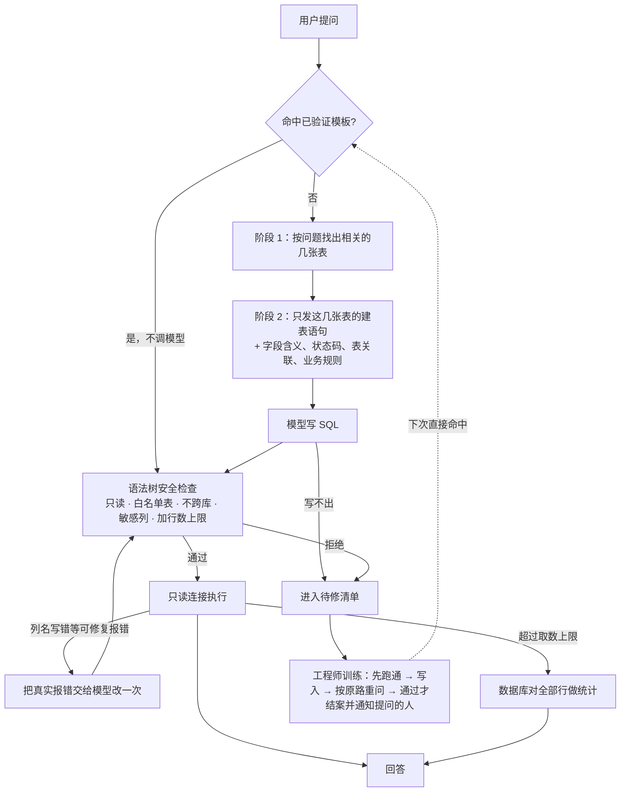

# 仓储 AI 问数演示 · warehouse-nl2sql-demo

用自然语言查询仓储数据：找出相关的表 → 模型写 SQL → 在语法树上做安全检查 → 只读执行 → 结果超过上限时由数据库做全量统计 → 答不了的进入待修清单，修好后按用户原来的路线重问，通过才生效。

> 这是我在工作中参与开发的仓储 AI 问数服务的**技术演示版**：用模拟数据把核心思路重新实现了一遍，**不包含任何公司代码、客户数据或配置**。所有表和数据都由 [`nl2sql_demo/data.py`](nl2sql_demo/data.py) 用固定随机种子生成。默认用离线的模拟模型运行，不需要任何 API key。

## 一次提问怎么走



## 关键设计，以及为什么

| 设计 | 为什么 | 代码 |
| --- | --- | --- |
| **两阶段检索**：先挑出相关的表，再只发这几张表的精确建表语句和业务知识 | 真实业务库有几百张表，全塞给模型又贵又容易用错表；模型最容易错的是语义（`status = 'D'` 是什么意思），不是语法 | [`knowledge.py`](nl2sql_demo/knowledge.py) |
| **已验证模板优先** | 常问的问题直接跑工程师验证过的 SQL：快、不花钱、每次结果一样 | [`templates.py`](nl2sql_demo/templates.py) |
| **在语法树上做安全检查** | 模型的 SQL 只是建议。用正则匹配表名容易被绕过（注释、`STRAIGHT_JOIN`、MySQL 的 `/*! */`）；解析成语法树后逐个检查表引用、语句类型、函数和敏感列 | [`guard.py`](nl2sql_demo/guard.py) |
| **只读连接** | 检查是内层防线，外层是连接本身只读：就算检查漏了，也写不进去 | [`tenancy.py`](nl2sql_demo/tenancy.py) |
| **超过取数上限时由数据库统计** | 只取前 1 万行再在内存里算合计、分布，结论就是错的；改为把原查询包成子查询，由数据库对全部行计算 | [`stats.py`](nl2sql_demo/stats.py) |
| **报错只修一次** | 列名写错这类错误，把数据库的真实报错交回模型修一次；权限、安全拦截这类错误不修 | [`pipeline.py`](nl2sql_demo/pipeline.py) |
| **多租户上下文** | 请求入口绑定租户，下游都从上下文读；没有租户就拒绝，绝不退回默认库；线程不继承上下文，后台任务必须带着上下文提交；知识按租户隔离（演示里两个租户对状态码 `X` 的含义就不同） | [`tenancy.py`](nl2sql_demo/tenancy.py) |
| **待修清单与训练闭环** | 同一个问题按指纹合并、按影响人数排序；训练顺序是先跑通 → 拍快照写入 → 不调模型、按用户原路重问 → 通过才结案并通知，否则回滚 | [`feedback.py`](nl2sql_demo/feedback.py) |
| **标准答案题评测** | 每道题带一条结果确定正确的 SQL，按"标准答案里的值都要出现在回答里"判分；换提示词或换模型前先跑一遍 | [`evals/`](evals) |

## 运行

需要 Python 3.10 及以上。

```bash
git clone <这个仓库的地址>
cd warehouse-nl2sql-demo
python -m venv .venv
source .venv/bin/activate        # Windows: .venv\Scripts\activate
pip install -e ".[dev]"

python -m nl2sql_demo tour                                    # 按顺序演示上面每一项
python -m nl2sql_demo ask "每个仓库有多少在途包裹？"
python -m nl2sql_demo ask --tenant globex "上个月送达了多少包裹？"
pytest                                                        # 38 个测试
python evals/run_golden.py                                    # 标准答案题
```

第一次运行会在 `demo_data/` 下生成两个租户的 SQLite 数据库（`acme` 约 2.4 万个包裹，`globex` 600 个）。

### 换成真实模型

默认的模拟模型只认识演示问题。要用 Claude：

```bash
pip install -e ".[claude]"
export ANTHROPIC_API_KEY=...     # 或用 ant auth login 登录
python -m nl2sql_demo --llm claude ask "哪个仓库的包裹箱数最多？"
python evals/run_golden.py --llm claude
```

调用的是 `claude-opus-5-5`，并打开了服务端的拒答兜底（模型拒答时，同一次调用里自动换备用模型重试）。

## 示例输出（节选自 `python -m nl2sql_demo tour`）

```text
=== 5. 结果超过取数上限：由数据库算全量统计，不拿前 N 行下结论
问题：列出所有已送达的包裹
SQL：SELECT tracking_no, warehouse_code, cartons, delivered_at FROM parcels WHERE status = 'D' LIMIT 10000
结果超过 10,000 行的取数上限，由数据库对全部 16,774 行做了统计：
  warehouse_code 分布：{'WH-N': 5626, 'WH-E': 5587, 'WH-S': 5561}
  cartons：合计 109,228，平均 6.51

=== 7. 试图读另一个租户的库：被拦下
SQL：SELECT * FROM globex.parcels
结果：没有回答 —— blocked: cross-database reference globex.parcels is not allowed

=== 工程师训练 #4：先跑通 → 写入 → 按用户原来的路线重问 → 通过才结案
  resolved；通知：alice, bob

=== 再问一次：直接命中模板，不调用模型
问题：哪些货主的包裹最多？
SQL 来源：已验证模板（没有调用模型）
```

## 目录

```text
nl2sql_demo/
  data.py        生成两个租户的模拟数据库
  tenancy.py     租户上下文、只读连接、带上下文的后台任务
  knowledge.py   每个租户的表知识；两阶段检索
  templates.py   已验证 SQL 模板
  guard.py       语法树安全检查、按数据库类型加行数上限
  stats.py       超过取数上限时的全量统计
  llm.py         模拟模型（默认）与 Claude
  pipeline.py    一次提问的完整流程
  feedback.py    待修清单与训练闭环
  __main__.py    命令行：tour / ask
evals/           标准答案题与评测脚本
tests/           单元测试
```

## 演示版做了哪些简化

- 阶段 1 用词袋相似度代替向量检索，接口不变，换成向量模型只需改 `retrieve`。
- 数据库用 SQLite；安全检查本身支持按 SQL Server、MySQL、PostgreSQL 的写法解析和加行数上限（`dialect` 参数）。
- 模板和待修清单存在内存里；实际系统存数据库，并有后台页面给工程师用。

## License

[MIT](LICENSE)
